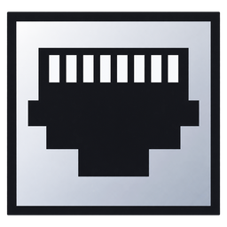

# SocketJack.Unity



Portable multiplayer networking for Unity games and dedicated .NET servers. Targets .NET Standard 2.1 with no third-party dependencies and no UnityEngine dependency in the runtime DLL.

**Release two** turns the networking foundation into a complete optional multiplayer toolkit. Use **Tools → SocketJack → Setup Multiplayer** to connect an existing player prefab, then choose 3D/2D prediction, selected field/property sync, Full/Balanced/Compact/custom precision, spatial visibility and lifecycle helpers. Optional modules add MMO chat and persistent Communities, accounts, a server-hosted website, linked-server Global chat, authenticated relays and Opus voice. See the included `ReleaseTwo.md` or the [illustrated Premium guides](https://github.com/hheiroww/SocketJack/blob/codex/unity-multiplayer/docs/unity-premium/index.md). The base remains dependency-free; Web and Voice have separately disclosed dependencies.

The package supplies independent topology/transport choices, server or opted-in owner authority, object spawning and state, player ownership, room visibility, fixed simulation ticks, bounded queues and Unity component sources. Add the supplied components to bring multiplayer to an existing game, then select the fields/properties to replicate. Game code defines its prefabs, input and simulation rules; arbitrary single-player logic still needs ownership and rule integration.

## Install

For a dedicated .NET server or a non-Unity integration:

```sh
dotnet add package SocketJack.Unity --version 2026.11.04.0
```

Unity 6 is the primary support target, with Unity 2022.3 LTS retained as a compatibility bracket. Use the .NET Standard 2.1 API compatibility level in either bracket. The included `QuickStart.md` explains the version matrix, required components and a complete single-player-to-multiplayer conversion, including host/join setup, prefab spawning, input and local cameras. Its acceptance matrix records the exact Editor/player versions actually verified.

Open the `.nupkg` as a ZIP archive, then copy:

1. `lib/netstandard2.1/SocketJack.Unity.dll` into `Assets/Plugins/SocketJack.Unity/`.
2. The `.cs` files and `link.xml` from `contentFiles/any/any/SocketJack.Unity/` into `Assets/SocketJack.Unity/`.

The component sources intentionally ship as content, rather than a DLL referencing one particular Unity Editor version. Ordinary .NET consumers do not compile them. Do not copy UnityEditor assemblies or `UnityAdapter.Verify.dll` into a game. The standalone multiplayer DLL can coexist with the base `SocketJack` package; it does not duplicate the base library's types.

The public C# namespace is `SocketJack.Multiplayer`, with Unity components in `SocketJack.Multiplayer.Components`. Starting with 2026.11.03.0, update older `using SocketJack.Unity...` statements to that namespace. The NuGet ID, assembly name and package paths remain `SocketJack.Unity`; this namespace change does not change the built-in wire protocol.

## First Unity game

Create a prefab with a collider and add `SocketJackObject` from `SocketJack.Multiplayer.Components`. Unity adds its required `NetworkIdentity` and `Rigidbody`. Add `NetworkManager` to an empty scene object. Register the same prefab list in the same order in every build; prefab IDs start at `1`. The prefab must be spawned by the authoritative manager: adding a component alone does not assign an existing scene object a shared network identity.

Choose **Host / Peer** topology for `StartHost()` and `StartPeer()`, or **Dedicated Server / Client** for `StartServer()` and `StartClient()`. Topology is independent of the UDP/TCP transport setting. Dedicated mode defaults to server authority. Both modes default to UDP and `127.0.0.1:7777`. For LAN/Internet peers/clients set `Address` before starting. Only the host/server opens a listening service and requests router forwarding. A peer/client uses an outbound connection and its normal return-traffic socket; it does not listen for new game connections or map a service port.

```csharp
using SocketJack.Multiplayer.Components;
using UnityEngine;

public sealed class GameBootstrap : MonoBehaviour
{
    public NetworkManager network;
    public GameObject playerPrefab;

    void Awake()
    {
        network.RegisterPrefabs(playerPrefab);
        network.Topology = NetworkTopology.HostPeer;
        network.PeerConnected += peer =>
            network.Spawn(1, new Vector3(0, 0.6f, 0), Quaternion.identity, ownerId: peer);
    }

    public void Host() => network.StartHost();
    public void Join() => network.StartPeer();

}
```

`SocketJackObject` reads WASD and arrow keys by default, with Space for jumping. Owner input takes effect immediately in local Rigidbody simulation. The owner sends 15-byte binary intent on changes, capped at 30 messages/s, with a 5 Hz keepalive; it does not transmit position every render/physics frame. The server validates ownership and bounded intent, simulates the same forces, and relays intent only to peers in the same room. Other clients also simulate their local Rigidbody from that intent.

Sparse 70-byte binary keyframes (5 Hz by default) repair physics divergence. Client correction uses capped extrapolation, bounded velocity correction, Rigidbody interpolation and optional child-visual smoothing. PhysX is not deterministic across machines: this is predictive local simulation with authoritative repair, rather than deterministic lockstep or full rollback. All byte counts above exclude protocol/IP headers. The physics component reserves application message ID `60001` for its input relay; member synchronization reserves `60003` and `60004`. The demo uses `60002` for RTT measurements; choose other IDs for game messages. Reliable relay backpressure is retained in a bounded retry queue, with overflow disconnecting a peer instead of silently losing accepted messages. Queued, unsent relay messages are revoked when the peer or object leaves the applicable room.

Configure movement mode, authority inheritance, input rate/keepalive, movement force/ForceMode, maximum speed, jump force, keyframe rate, timeout, correction limits, extrapolation, owner correction weight and visual smoothing in the Inspector. Movement uses ForceMode.Force by default, so the native Rigidbody mass affects acceleration. Rigidbody mass, drag, angular drag, gravity, constraints, collision mode, interpolation and Collider material/friction remain the object's native settings; the component does not replace them. Enable Rigidbody interpolation in its own Inspector when desired. For the Input System or a custom controller, disable **Read Keyboard** and call `SetInput(horizontal, vertical, jump)` on the owning object's component. Assign a child renderer transform as **Visual** to absorb rare large corrections without moving the collider for rendering alone. Do not add `NetworkTransform` to the same Rigidbody: the manager rejects conflicting controllers.

| SocketJackObject movement option | Rigidbody | Existing colliders |
| --- | --- | --- |
| Static w/Colliders Enabled | Kinematic | Enabled |
| Static | Kinematic | Disabled |
| Physics Enabled | Dynamic | Disabled |
| Physics w/Colliders Enabled (default) | Dynamic | Enabled |

These modes change only `isKinematic` and collider enabled flags. They do not set Unity's lightmapping/static-batching flags or invent collider shapes. Configure the object's native Rigidbody and colliders for its game role.

**Server Authority** controls whose state is canonical. When enabled, the server simulates/validates game state and repairs client prediction. When disabled for an owned object, its owner sends bounded binary keyframes through `SendOwnerState`; the server checks ownership, room, sequence, limits and the configured validator, then relays that canonical owner state. It does not overwrite those objects with its own simulation snapshots. Owner clients do not reconcile against their own echoed state. Other clients and the server still simulate from input and repair toward the owner's keyframes. Server-owned objects always retain server authority. Keep server authority for an MMO or other game that must enforce authoritative game rules; owner authority is an explicit trust choice for cooperative/peer games.

Objects default to **Inherit Manager** authority, with per-prefab **Server** or **Owner** overrides. The server selects the policy at spawn and transmits it to clients; changing a client's Inspector cannot grant authority. Respawn after changing an object's authority configuration. The Unity manager validates physical/transform binary data; custom owner-state codecs must supply `OwnerStateValidator`.

For objects that only need server-driven transform replication, the separate `NetworkTransform` and `ExamplePlayerController` remain available. That simpler 40-byte transform codec interpolates position/rotation/scale and does not simulate client physics. Use your own codec/controller for game-specific state, prediction or lag compensation.

Destroy network objects through `NetworkManager.Despawn` on the server. Call `Shutdown` before restarting or reconfiguring the manager. Shutdown destroys managed instances and disposes both host/client transports. Callbacks execute on the thread pumping `Update`; the Unity manager does so on Unity's main thread.

## Selected fields, properties and serializers

Add `SocketJackMemberSync` to a network prefab to replicate selected fields and readable/writable properties on its components. It can accompany either movement synchronizer without replacing the physics/transform payload. Discover members in the Inspector, then opt in individually and select **Server** or owning-client (**Owner**) authority, send interval, change-only behavior and serialized byte limit. The server's schema controls permissions independently for each member, including when movement retains server authority.

Canonical values have late-join/room-entry baselines, per-member revisions and view tokens; pending state coalesces and retries under backpressure. This is current-state replication rather than an event log. Static/readonly/indexed members and automatic Unity asset/object graph transfer are excluded. A custom serializer or registered codec can add supported value types. Preserve reflected game members when using managed stripping/IL2CPP, and validate trusted gameplay decisions on the server.

The manager defaults to **Binary formatter (SocketJack)**, the bounded typed `SocketJack.Multiplayer.Serialization.SocketJackBinaryFormatter`. It is independent of .NET `BinaryFormatter`. Choose a custom provider implementing `INetworkSerializerProvider` or set the manager's serializer override before starting. `INetworkSerializer` exposes a stable `ProtocolId`, support checks and bounded serialization/deserialization. Peers must use the same serializer settings and prefab schema. Register custom default-formatter codecs before the registry freezes on its first `ProtocolId` read. Custom serializers apply to member values; lifecycle and physics wire formats remain explicit binary protocols.

See the included `QuickStart.md` for the component settings and a single-player conversion example, including server-controlled health and an owner-controlled display name.

Standalone .NET integrations can use `NetworkMemberSchema`, `NetworkMemberBinding` and the manually pumped `NetworkMemberServer`/`NetworkMemberClient`. Build identical explicit schema keys and formatter registries on both ends; a plain runtime formatter does not automatically register Unity types. Set the session's `MaxMessageBytes` to at least `44 +` the largest selected member limit (the Unity manager uses 8,236). Dispose/recreate the member coordinators whenever their session is stopped/restarted, so a new object-ID space gets fresh subscriptions and view history. Work, traffic, cache and subscription limits are configured through `NetworkMemberSyncOptions` before starting.

## Transport contracts

Choose **Udp** (default), **Tcp** or **WebSocket**, or configure `NetworkManager.TransportFactory` before starting for a relay/custom provider. Native listeners support host/peer and dedicated server/client. WebGL clients use `SocketJackBrowserTransport` and cannot host a listener. All participants must use compatible transport settings; there is no automatic fallback.

| Type | Behavior | Use |
| --- | --- | --- |
| `Udp` | Single nonblocking server socket; independent channel sequencing, acknowledgments and bounded retransmission for reliable messages | Realtime movement and state |
| `Tcp` | Framed ordered stream; every delivery mode arrives reliably in stream order | Turn-based games, tools, networks allowing TCP only |
| `WebSocket` | Bounded binary native WS/WSS transport; browser JavaScript bridge for WebGL | Browser gameplay, TLS and self-hosted WebSocket relay |
| `Custom` | Implement `IGameTransport` and pass it to `NetworkServer`/`NetworkClient` | Platform services, relays or browser bridges |

`DeliveryMode.ReliableUnordered` (alias `Reliable`) is the default for application traffic: packets are acknowledged/retried and duplicate-filtered, without holding a later message behind an earlier missing one. `ReliableOrdered` is available when ordering is explicitly needed; lifecycle messages use it. `Unreliable` allows loss/reordering, and `UnreliableSequenced` discards stale channel sequence numbers. UDP keeps reliable ordered/unordered histories separate. TCP preserves its underlying reliable stream order for every mode and cannot remove TCP head-of-line blocking. There is no silent fallback between transport types.

`PacketBudget` includes IP, UDP, reliability, object-frame and session headers. Default path MTU is 1,280 bytes, with a conservative 40-byte IPv6 header budget. UDP session object frames keep the complete reserved IP packet strictly below 999 bytes; account for tunnels/extensions through `ExtraPacketOverheadBytes`. Raw native sends must fit their payload limit. `NetworkServer`/`NetworkClient` automatically wrap transports with `ObjectFrameTransport`: larger logical objects/messages split into bounded frames and reconstruct before delivery. Single-frame messages avoid multipart reassembly. Fragments use reliable unordered delivery; the original logical delivery contract is restored after reconstruction. This is application framing, so it avoids relying on IP fragmentation. TCP can independently coalesce or split stream writes into IP packets.

The bounded `ObjectRebuilder` implementation is shared with the core SocketJack TCP/UDP decoder. Reconstruction is isolated per peer, enforces byte/object/time limits, and delivers a complete object once. The default logical-message limit is 65,535 bytes; configure session state/message limits within that envelope. Larger data does not silently bypass the configured memory limits.

| Default UDP packet contribution | Owner input | Physics keyframe |
| --- | ---: | ---: |
| IPv6 + UDP | 48 | 48 |
| SocketJack reliable/datagram header | 40 | 40 |
| Object frame header | 28 | 28 |
| Session header | 24 | 24 |
| `PhysicsBinarySerializer` payload | 15 | 70 |
| **Complete reserved IP packet** | **155 bytes** | **210 bytes** |

A full fragment carries up to 882 bytes of logical data plus 116 bytes of framing/network overhead, totaling 998 bytes. A lower MTU or an extra encapsulation reserve reduces that capacity automatically. This packet budget is separate from the size of the rebuilt logical object.

Logical message, per-peer queued/reassembly byte counts, concurrent objects and expiration are bounded by `ObjectFrameOptions`; session state/message bounds must also fit those limits. The shared `ObjectRebuilder` validates total size, offsets, overlap, consistency and timeouts. `Send`/`SendMessage` returning `false` means disconnected or backpressured: retry reliable application messages after a later update. Internal reliable lifecycle queues are bounded; a client unable to keep up is disconnected instead of receiving an incomplete object view.

The session reserves channel `0` for reliable lifecycle messages, `1` for state snapshots and `2` for owner inputs. Application messages use channel `3` by default. A custom transport must provide at least these four channels and preserve the delivery contracts.

Both built-in endpoints must use the same `MaxPacketSize` and `Channels` settings; a mismatch is rejected during the transport handshake. Release two uses **session protocol version 3** with ownership epochs, per-view tokens and compatibility admission, plus member protocol 2. Update every peer and server together; release-one sessions cannot mix with this release. They use a game-specific wire protocol and do not interoperate with the base library's `UdpClient`/`UdpServer` or reliable bulk-transfer protocol.

## Authoritative runtime

Use `NetworkServer` and `NetworkClient` directly when you do not need the supplied Unity components:

```csharp
using System.Net;
using SocketJack.Multiplayer;
using SocketJack.Multiplayer.Transport;

using var server = new NetworkServer(GameTransport.Create(TransportType.Udp));
server.PeerConnected += peer => server.Spawn(1, ownerId: peer, state: new byte[] { 100 });
server.InputReceived += input =>
{
    // Validate the player's intent against authoritative game rules.
    // Only this server changes replicated state.
    server.SetState(input.ObjectId, new byte[] { 99 });
};
server.Start(new IPEndPoint(IPAddress.Any, 7777));

// In the game/server loop, supply elapsed monotonic time in seconds:
server.Update(deltaSeconds: 1.0 / 30, maxEvents: 4096);
```

Continue pumping the server in a real loop; the final line above illustrates one iteration. Dispose sessions on shutdown. All transport and session operations belong to one thread. No per-player thread or background simulation is created.

State consists of bounded `byte[]` messages with explicit binary framing. There is no automatic CLR type activation, RPC reflection or runtime code generation. Clients send inputs for owned objects; server-authoritative objects take canonical state from the server, while explicitly owner-authoritative objects accept validated owner keyframes. Use `SendMessage(ushort messageId, byte[] payload, ...)` for explicitly defined application commands/events.

Late joiners receive reliable object baselines, streamed within the per-update budget. `SetPeerRoom` clears the old room view and streams reliable baselines for the new room; client despawn callbacks remove the old objects. `SetObjectRoom` moves an object's visibility. Move an owning peer to the destination room before moving its object. A disconnected owner's objects are despawned. Rooms are a visibility partition, not an authentication or authorization system: only trusted server code assigns them. The supplied host manager renders the authoritative world once; game-specific local rendering filters are needed if the host's view should hide other rooms.

## Capacity and operating limits

Defaults allow 4,096 connected peers, but this is a capacity limit, not a promised production player count. Thousands of users require room/interest partitioning, a suitable snapshot rate, bandwidth capacity and a dedicated-server process/fleet sized for the actual game workload. Do not broadcast every object to every player. Simulations involving thousands of mutually visible players require additional game-specific interest filtering, aggregation or sharding.

`NetworkSessionOptions` controls tick/snapshot rates, catch-up limits, per-peer queues, inbound message rates and per-update work. The headless runtime defaults to 30 simulation ticks/s and 10 snapshot rounds/s; the Unity manager defaults to 30 ticks/s and 5 snapshot rounds/s, while the physics sample simulates at 60 Hz with 5 Hz keyframes. Other defaults include 64 state updates per peer per snapshot round, 1,024 state/message bytes, 4,096 objects per room, 100,000 objects per server and 240 inbound messages/peer/s. The reliable session queue is capped at 1 MiB and 1,024 messages per peer; initial baselines stream object IDs/canonical state instead of eagerly filling that queue. State cycles revisit unchanged objects so later snapshots repair packet loss. A room with more visible objects than its snapshot budget takes multiple rounds to refresh. Configure and measure that latency for your game. `TransportOptions` separately bounds packet size, connection data, reliable backlog, timeouts and admitted peers. Raising caps increases memory/network cost; it does not create server capacity.

UDP admission uses an endpoint-bound cookie challenge before allocating peer state. Set `TransportOptions.ConnectionValidator` (or the Unity manager's `ConnectionValidator`) before starting to validate a short-lived game ticket. Direct UDP/TCP carry plaintext game data; UDP relay credentials authenticate routing without encrypting payloads. Native WebSocket supports TLS/WSS. Never transmit reusable account passwords through `connectionData`. Optional Web/Voice packages add ticketed admission, accounts, persistence, a website, authenticated self-hosted relays and linked-server chat/voice. Operators provide their hosting, certificates and deployment configuration; universal matchmaking and automatic process orchestration are not included.

**Automatic Port Forwarding** is enabled by default and runs only after a host/server has bound its listening port. It asynchronously discovers a UPnP gateway and requests that exact UDP/TCP service mapping, with a finite renewable lease. A peer/client never requests a mapping. Results and the external endpoint are collected on the Unity main thread through `PortMappingStatus`, `IsPortMapped` and `ExternalEndpoint`; mapping failure does not stop LAN/local gameplay. Shutdown cancels discovery and releases mappings this instance owns. An existing compatible mapping is reused without being claimed, renewed or deleted. Automated sample checks explicitly disable UPnP so tests do not alter a real router. Gateways without UPnP, upstream carrier NAT and Windows firewall policy still require an appropriate network arrangement.

WebGL cannot use raw UDP/TCP sockets. Add/configure `SocketJackBrowserTransport` for the browser-native WebSocket bridge. Actual Unity 2022.3 WebGL/IL2CPP checks cover direct and relayed gameplay; Unity 6 WebGL and other platform/backend combinations need their own player acceptance. Preserve explicitly selected reflected game members through the game's linker configuration, or use code-authored member bindings.

## Build and verification

The source checkout includes a real Unity/PhysX cube game in [`Examples/UnityPhysics`](../Examples/UnityPhysics/README.md), with visible host/client menus, WASD/arrow sliding, a headless-server role, a Windows-player build menu and a server-plus-two-client metrics harness. See its README to prepare dependencies, build the actual Unity player and run it. Building/running requires an installed, activated Unity Editor; managed reference compilation alone does not establish player acceptance or smooth gameplay.

```sh
dotnet test SocketJack.Unity.Tests/SocketJack.Unity.Tests.csproj -c Release
dotnet pack SocketJack.Unity/SocketJack.Unity.csproj -c Release -o ./artifacts/unity
pwsh -File tools/Verify-UnityPackage.ps1 -Package ./artifacts/unity/SocketJack.Unity.2026.11.4.nupkg
```

From a repository checkout with Unity installed, compile component sources against the real Editor reference assemblies:

```powershell
dotnet build tools/UnityAdapter.Verify/UnityAdapter.Verify.csproj -c Release `
  '-p:UnityManagedPath=C:\Program Files\Unity\Hub\Editor\2022.3.17f1\Editor\Data\Managed'
```

Add `-p:IncludePhysicsSample=true` to compile the sample's game and Editor build scripts against the real installed Editor reference assemblies as well.

When invoking this .NET reference-only check for Unity 6, pass the appropriate `UNITY_6000_0_OR_NEWER` and input-backend compilation symbols explicitly; MSBuild does not infer Unity symbols from the reference path. A real Unity Editor sets its own symbols. Use `tools/Test-UnityEditorCompatibility.ps1` with an explicit Editor, verified runtime and owned output directory to compile/build the sample in a separate project for each support bracket without upgrading the source project.

This compile check does not establish player/IL2CPP or live gameplay acceptance. CI tests the managed runtime on Windows and Linux, packs with an explicit content allowlist, and preserves the package with SHA-256 checksums. Publish through `dotnet.yml` using `workflow_dispatch` with `releaseTarget: unity`; `unity.yml` validates only. Publication requires a matching date-code release version and uses the existing NuGet trusted-publishing policy.

Unity's [.NET compatibility documentation](https://docs.unity.com/en-us/engine/6000.0/manual/programming-environment/overview-of-dot-net-in-unity/dotnet-profile-support) and [Web .NET API restrictions](https://docs.unity.com/en-us/engine/6000.5/manual/platform-specific/webgl/develop/web-dotnet-api-support) describe the relevant platform constraints.
