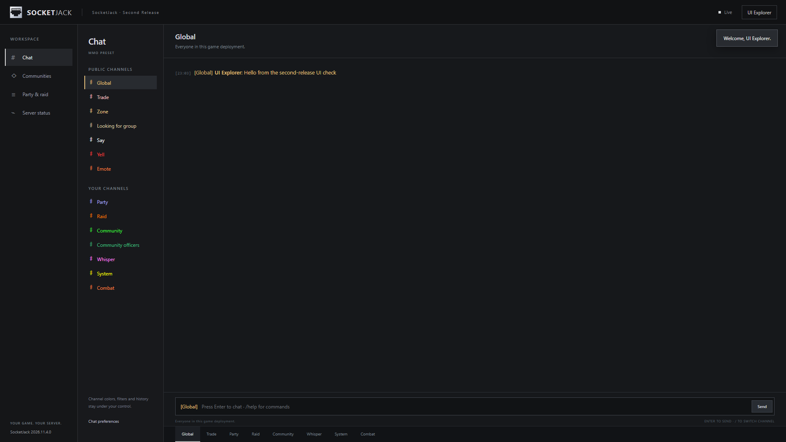
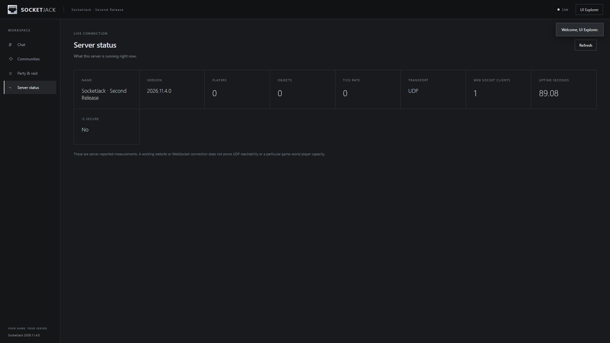
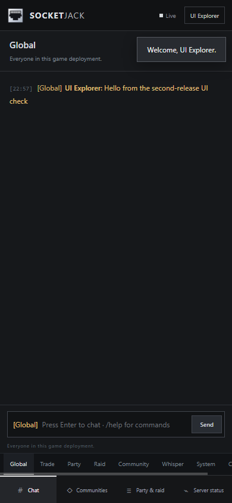

# Accounts and hosting

This guide adds sign-in, a server-hosted website and ticketed game entry to an already working multiplayer scene. SocketJack Premium supplies the optional modules and Unity components together. You operate the backend and keep its account data; a SocketJack.com account or a hosted subscription is not required.

Complete [Installation and first connection](installation.md) first. Use matching SDK versions, prefab registries, member schemas and serializer settings in every player and server. Authentication identifies a player; your server still validates that player's gameplay actions.

## 1. Choose the server and client pieces

| Piece | Add it to | Purpose |
| --- | --- | --- |
| `SocketJackWebHost` | The native server's `NetworkManager` object | Starts the website, account/API service and private store when the game listener starts. |
| `SocketJackWebClientBehaviour` | A client services/UI object | Signs in, maintains the realtime account connection and requests game tickets. |
| `SocketJackMMOChatPanel` | The same client UI object | Supplies registration/sign-in controls and chat. It requires the social panel and account behaviour. |
| `SocketJackWebSessionControls` | The manager/account services object | Supplies the listener → sign-in → authenticated game-join menu. |

The setup wizard's optional MMO/accounts/site choice adds this surrounding workflow. A newly configured wizard host requires game accounts. When adding the host manually, enable **Require Game Account** yourself if anonymous gameplay must be rejected.

Ordinary clients do not open the website listener or create the account database. A WebGL player is a client: it cannot host the native website, SQLite store or raw UDP/TCP listener. The native website and a separate WebGL game page can coexist, but building your game's WebGL output does not automatically add it to the bundled website.

For NuGet applications, the relevant packages are `SocketJack.Unity.Web.Client` and `SocketJack.Unity.Web`. Install matching versions. The complete Unity distribution already includes their approved dependencies and editable component sources; do not import a second copy of the assemblies.

## 2. Start with a local website

On the server's `SocketJackWebHost`, retain these development settings:

| Inspector field | Local value or action |
| --- | --- |
| Server Name | A readable name, such as `Example Arena`. |
| Node Id | A stable unique name, such as `local`. Keep it stable between restarts. |
| Bind Address | `127.0.0.1`. This deliberately accepts only local connections. |
| Web Port | `7778`, or another unused port. This is separate from the game port. |
| Data Directory | Empty uses the private default described below. |
| Certificate Path | Empty for this loopback-only HTTP test. |
| Hub Address | Empty for a standalone canonical backend. |
| Require Game Account | Enabled for the authenticated workflow. |

On the client, set **Server Address** on `SocketJackWebClientBehaviour` to `http://127.0.0.1:7778`. The chat panel also has an editable endpoint for its sign-in controls; keep that endpoint consistent. A URL entered in the supplied account UI changes the account service, not the manager's game transport endpoint.

Enter Play Mode. In the supplied account-aware menu, choose **Start host / server listener**. For Host/Peer this starts the listener without creating an anonymous local player. For a dedicated server it starts the listening server. Wait until the Web Host Inspector's **Website** field has an address and `LastError` is empty. Open that address on the same machine.

**Expected result:** the bundled website loads at `http://127.0.0.1:7778`, and the game listener is running. The host's local player has not joined yet. If another application owns that port, change the Web Port and the client's account URL together.

The website includes its own HTML, CSS, JavaScript and logo. It needs no external CDN or font service. The default site is embedded in the backend DLL for standalone delivery; editable website sources also ship with the module. Editing those source files does not hot-replace an already embedded site's bytes: rebuild the backend to publish those changes.



*The actual bundled website in an isolated local browser test. The account and message are synthetic; no setup code or credentials are shown.*

The site also provides a **Server status** page. Its player/object/tick counters come from the game host's status provider. A standalone website test can correctly show zero players; a live account socket is a separate connection from the game transport.



*This local website-only capture shows one account socket and no running game-world simulation. It illustrates the status fields, rather than a capacity result.*

On narrow screens, navigation moves below the chat and the channel strip scrolls. The same account and server APIs are used; this is the responsive website, not an embedded game client.



*Actual browser capture at a 390 × 844 CSS-pixel viewport. Test accounts and text are synthetic.*

## 3. Create the first administrator locally

Before an administrator exists, the native Web Host exposes a one-time setup code. In the running Inspector, enable **Show setup code** only when you need to read it. The field is masked by default. Use the website's first-server setup form from the server's loopback address to create the first administrator.

Keep the setup code out of screenshots, logs, scene assets, chat and client builds. Setup is loopback-only even when the service has a public HTTPS address. A remote player's ordinary registration cannot create an administrator. Once an administrator exists, this initial setup route cannot create another first administrator.

The default provider accepts usernames of 3–32 letters, numbers or underscores, starting with a letter. Usernames normalize to lowercase. New passwords must contain 12–128 characters; display names contain 1–48 characters without control characters. Enter a unique password through the UI; no working password belongs in a script or prefab.

**Expected result:** the account has administrative controls, while a separately registered player account has player permissions. The website's diagnostics, enrollment and moderation operations require administrator permission.

For a headless server, expose `SocketJackWebHost.BootstrapCode` through your own protected local administration channel if needed. Do not add it to public status responses or automatically print it into shared server logs. This package does not install a remote administration service for you.

## 4. Join through a game ticket

Use two separate player accounts to test. Register or sign in through the chat panel, then choose **Join authenticated game**. A Host/Peer listener joins its local player with `ConnectLocalHostAsync`; a remote player uses `JoinGameAsync`.

The account client requests `game/ticket`. The returned admission bytes are short-lived and one-use; the normal transport handshake and server validator still run. The Web Host binds an accepted peer to the authenticated account. Use `TryGetAuthenticatedAccount(peerId, out account)` on the server when your trusted game code needs that binding.

For a custom menu, these are the actual public methods:

```csharp
using System.Threading.Tasks;
using SocketJack.Multiplayer.Components;
using SocketJack.Multiplayer.Web.Components;

public static class AccountGameEntry
{
    // Call from your UI on Unity's main thread. Read credentials from input fields.
    public static async Task JoinAsync(
        SocketJackWebClientBehaviour accounts,
        NetworkManager manager,
        string username,
        string password,
        string serverId = "")
    {
        await accounts.LoginAsync(username, password);
        await accounts.JoinGameAsync(manager, serverId);
    }

    // StartHostListener must already be running and its website must be ready.
    public static async Task JoinLocalHostAsync(
        SocketJackWebClientBehaviour accounts,
        NetworkManager manager,
        string username,
        string password)
    {
        await accounts.LoginAsync(username, password);
        await accounts.ConnectLocalHostAsync(manager);
    }
}
```

Catch exceptions in the UI that calls these methods and display the error. Disable repeated join clicks while a request is pending. Do not block Unity with `.Wait()` or `.Result`. `SocketJackWebClientBehaviour` supplies main-thread callbacks and the WebGL-specific HTTP/WebSocket adapters automatically.

An empty `serverId` selects the account endpoint's own game server. When authenticating through a canonical hub for a leaf server, pass its enrolled node ID. **A node ID selects ticket admission; it does not discover or change the game address/port.** Configure the manager's destination separately. Native UDP/TCP `NetworkManager.Address` expects an IP literal; the default local value is `127.0.0.1`. A URI-based WebSocket transport supplies its own hostname handling.

**Expected result:** each authenticated peer gets its own player and ready baseline. An anonymous client is denied while Require Game Account is enabled. Calling anonymous `StartHost()` is not a replacement for this listener-first host flow.

## 5. Keep persistent data private

By default the Unity host stores `accounts.sqlite` beneath:

```text
Application.persistentDataPath/SocketJack/<nodeId>/
```

This is a runtime location, not a literal path to paste into a scene. You may choose a different writable Data Directory. Use a separate directory for each node. Keep it outside Assets, source control, public website files and player-download archives. Restrict filesystem access to the server identity and your backup/administration process.

The supplied `SqliteAccountStore` uses the operating-system SQLite C API:

| Native host | Requirement |
| --- | --- |
| Windows 10/11 | OS `winsqlite3.dll`. The package does not bundle a replacement DLL. |
| Linux | `libsqlite3.so.0`, SQLite 3.24 or newer. Debian/Ubuntu commonly provide it through `libsqlite3-0`. Install the distribution's maintained runtime package. |
| Other native platforms | Supply and test compatible `IAccountStore`/`ISocialStore` implementations instead of assuming this loader exists. |

The store uses WAL mode. Use a SQLite-aware backup, or stop the service cleanly and back up its closed database consistently. Do not assume copying only the main file while it is live captures all committed changes; the WAL is part of database state. See SQLite's [WAL documentation](https://sqlite.org/wal.html). Restore a backup in an isolated test before relying on it.

The default provider uses salted PBKDF2-SHA256 password hashes with 600,000 iterations and bounded hashing workers. Stored account-session keys are hashes, not reusable bearer values. Default sessions last 12 hours and can be revoked. These protections do not encrypt the database file, provide email delivery, implement MFA or define your game's retention policy. `accounts/reset-password` is an administrator operation; automated email recovery is not included.

The supplied game client keeps bearer values in memory. It does not automatically persist sign-in across application restarts. If you add persistence, use an appropriate platform secret store and a deliberate sign-out/revocation flow; do not put bearer values in PlayerPrefs or ordinary game-save synchronization.

## 6. Move from loopback to HTTPS/WSS

Do this after the complete local join test passes:

1. Obtain a certificate whose name matches your public account hostname, for example `game.example`. Make its private-key PFX accessible only to the native server identity, outside Assets and downloadable files.
2. Set **Certificate Path** to that PFX. Set **Certificate Password Environment** to the name of an environment variable available to the server process; the default is `SOCKETJACK_WEB_CERTIFICATE_PASSWORD`. Supply its value through your host's secret configuration, not a serialized scene field.
3. Set **Bind Address** to the intended IP interface, or an appropriate wildcard such as `0.0.0.0`. This field is an IP bind address, not the hostname. A non-loopback account listener without a certificate is rejected.
4. Configure the native host/firewall/NAT and public DNS for the account port. A successful local bind does not establish external reachability. Automatic game-port mapping does not configure every website, relay, DNS or certificate requirement.
5. Point the client to `https://game.example:7778`. For a separately hosted browser game, add its exact origin, such as `https://play.game.example`, to **Allowed Origins**. Origins contain scheme, hostname and optional port, without a path. Wildcards are not accepted. An empty list permits same-origin browsers and native clients without an Origin header.
6. Test from an external connection: trusted certificate, sign-in, realtime text, game-ticket join and sign-out. Configure WSS for browser gameplay and optional voice as described in their guides. Never bypass certificate validation to make the test pass.

The supplied listener can terminate TLS directly. If you introduce a reverse proxy, configure and test its trust boundary, WebSocket upgrade, timeouts and origin behavior explicitly. Do not assume forwarded headers change the backend's loopback or transport-security decisions.

## Troubleshooting

| Symptom | Check |
| --- | --- |
| No website address | Start the native game listener, wait for `SocketJackWebHost.Started`, then inspect `LastError`. Ordinary clients and WebGL cannot host it. |
| Website works only on the host | The default bind is loopback. Public binding requires TLS, a reachable address and explicit network policy. |
| SQLite library error | Check the OS library name/version and process architecture. Do not add unrelated SQLite wrappers or ship an arbitrary native DLL. |
| First-account setup is rejected | Use the server's loopback address, a current local setup code and a database without an existing administrator. Ordinary registration is a different operation. |
| Signed in, game join denied | Check Require Game Account, ticket freshness, correct target node, account revocation, prefab/schema compatibility and the separately configured game destination. Request a new ticket for a new attempt. |
| Browser HTTP or socket is blocked | Check HTTPS/WSS, exact Allowed Origins and the UnityWebRequest module. Use the supplied WebGL adapter and `.jslib`; native sockets cannot substitute in WebGL. |
| Repeated 429 responses | Back off authentication/API requests. The backend deliberately bounds expensive password work and request rates; do not retry every frame. |
| Sign-out leaves custom gameplay/UI state | Await `LogoutAsync`, react to `SignedOut`, and stop your own game/UI work. The supplied services revoke related permissions; custom state needs its own reset. |

## Verification and next steps

Real Windows Unity players have exercised the account/site components in Unity 6.3 and 2022.3. An actual Unity 2022.3 WebGL/IL2CPP browser client has exercised registration, logout/login, concurrent API requests, realtime chat and account voice. Portable hosting tests cover authorization, SQLite persistence, TLS, linked nodes and relays. These checks do not establish your certificate renewal, backup recovery, native Linux player build or public-network capacity.

Continue with [Chat and Communities](chat-and-communities.md), [Voice](voice.md) and [Relays and linked servers](relays-and-linked-servers.md). Public source references: [Web Host component](https://github.com/hheiroww/SocketJack/blob/codex/unity-multiplayer/SocketJack.Unity.Web/Unity/SocketJackWebHost.cs), [account client](https://github.com/hheiroww/SocketJack/blob/codex/unity-multiplayer/SocketJack.Unity.Web/Runtime/SocketJackWebClient.cs), [account provider](https://github.com/hheiroww/SocketJack/blob/codex/unity-multiplayer/SocketJack.Unity.Web/Runtime/Accounts.cs).
