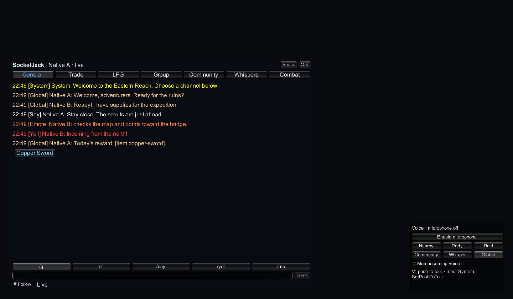
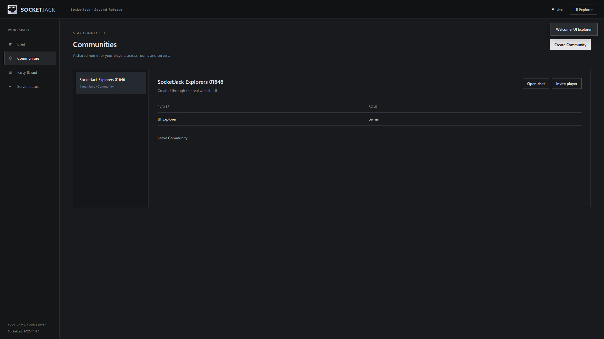
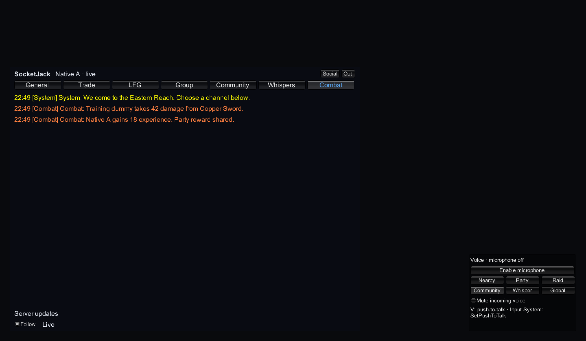

# Chat and Communities

Add account-backed text chat, parties, raids and persistent Communities to a working game. The supplied panels provide a starting UI; the same authorized operations are available to your own menus. Communities are social groups with roles and invitations, not network rooms or scene instances.

Finish [Accounts and hosting](accounts-and-hosting.md) first. For the first test, run one native backend and sign in with two different player accounts. Both can use the website, Unity UI or one of each. You do not need a game player just to participate in Global, Trade or Community chat. Position-based channels require authenticated game presence.

## 1. Add the supplied UI

1. On a client services/UI object, add `SocketJackWebClientBehaviour` and point its Server Address at your backend. Use `http://127.0.0.1:7778` for same-machine development and HTTPS for remote accounts.
2. Add `SocketJackMMOChatPanel`. Its required components include `SocketJackSocialPanel` and the account behaviour. Keep the panel on the services/UI object rather than every spawned player prefab.
3. Keep the chat panel's editable Endpoint consistent with the backend. Sign in or register through its account controls.
4. Select the General tab and send a short Global message. Confirm that the other account receives it once, with the correct display name/channel.
5. Enter `/social` to open the Communities and groups panel, or call `SocketJackSocialPanel.Toggle()` from your own UI.

**Expected result:** signed-in clients share Global chat, while each client retains its own account identity. A closed game session may still leave the account signed in for chat; stopping gameplay and signing out are distinct actions.

The panel buffers a bounded number of messages and uses scrollable tabs. It is an editable example UI, not a requirement to use IMGUI throughout your game. A custom Canvas/UI Toolkit interface can subscribe to `SocketJackWebClientBehaviour.MessageReceived` and call the public methods below. Do not render network text as executable HTML, rich-text commands or scripts. Unsubscribe your custom handlers when their UI is disabled or destroyed.



This Unity 2022.3 capture uses synthetic accounts and messages. It shows the supplied panel, including a server-registered item link; the microphone remains off.

## 2. Choose tabs, colors and channels

Create an asset with **Create → SocketJack → MMO chat preset**, then assign it to the chat panel's Preset field. Its context menu can explicitly apply MMO, Cooperative or Arena defaults. Custom retains the current definitions. Changing the preset selection does not silently rewrite your existing definitions; use the apply action when you intend to replace them.

Edit Font Size, Width, Height, Message Capacity, timestamp/account-control visibility, colors and Tabs. Each tab has a default Send Channel and a list of Visible Channels. Hiding a channel in a tab is a local display choice; it does not grant or revoke server membership.

| Channel / API name | Who can receive it | Common command |
| --- | --- | --- |
| Global / `global` | Online users in the canonical social service; linked leaves share that service. | `/g` |
| Trade / `trade` | Global-style audience. | `/trade` |
| Looking for Group / `lfg` | Global-style audience. | `/lfg` |
| Zone / `zone` | Validated game presences in the same world and room. | `/z` |
| Say / `proximity` | Same world/room and within the default 30-unit range. | `/say` |
| Yell / `yell` | Same world/room and within the default 100-unit range. | `/yell` |
| Emote / `emote` | Position-scoped audience, using the proximity range. | `/me` |
| Party / `party` | Online members of the selected party. | `/p` |
| Raid / `raid` | Online members of the selected raid. | `/raid` |
| Community / `community` | Online members of the selected Community. | `/c` |
| Officers / `officer` | The Community's Owner and Officers. | `/co` |
| Whisper / `whisper` | The online target and sender, subject to ignore rules. | `/w username message` |
| System / `system`, Combat / `combat` | Explicit recipients chosen by trusted server integration. Players cannot publish these channels. | Read-only |

These are routing rules, not guarantees that every recipient is connected or retains unlimited history. Default proximity distances use your game's world units. The portable `SocialOptions` exposes range and capacity settings for custom service integrations; changing a label/color in the Unity preset does not change server routing distances.

### Trusted position matters

The Unity Web Host publishes presence from `NetworkPlayerSpawner.TryGetPlayer`. If you have your own player spawner, set `SocketJackWebHost.PresenceObjectResolver` to return the account peer's authoritative player identity. Do this on the server's main thread. Do not select a projectile or the first arbitrary object a peer owns, and do not accept position fields from a browser chat request.

The host uses World Id, or Node Id when World Id is empty, together with the player's Room Id. Two leaf servers with different default worlds do not become proximity neighbors just because their coordinates match. If your game deliberately shares a world across nodes, set its world IDs and routing rules consistently.

**Expected result:** two nearby admitted players can Say; moving apart beyond the range removes delivery. A website-only account can use Global but receives a validation error when trying to send proximity chat without a current game presence.

## 3. Create a Community and invite another player

In the Social panel:

1. Open **Communities** and create a named Community. Disable Open Membership for an invite-only test.
2. Select it. Its creator is the Owner.
3. Enter the other account's username and choose **Invite**.
4. On the other account, open **Invitations** and choose **Accept**.
5. Select that Community in both panels and send `/c Hello builders`.
6. As Owner, select the other member and change the role to Officer. Test `/co` from both accounts.
7. Change that account back to Member and confirm officer chat is denied for it.

The Social panel updates the chat panel's `CommunityId`, `PartyId` and `RaidId` after membership refresh. A scope ID identifies the requested group; the server independently checks membership and role. Copying an ID into a client never grants access.

The hosted website offers the same account-backed Community workflow. Open **Communities**, choose **Create Community**, enter its name and description, then invite another account from its membership page. Membership persists in the server's private store and is shared with the game's Social panel after refresh.



*Actual local browser capture after creating a Community through the website. The account and Community are synthetic.*

For your own UI, the following uses real operation names and response fields. The methods operate on an already signed-in account behaviour:

```csharp
using System.Threading.Tasks;
using SocketJack.Multiplayer.Web.Components;

public static class CommunityMenu
{
    public static async Task<string> CreateAndInviteAsync(
        SocketJackWebClientBehaviour accounts, string invitedUsername)
    {
        var community = await accounts.Client.RequestAsync(
            "communities/create",
            new { name = "Builders", description = "Our cooperative group", isOpen = false });
        string id = community.GetProperty("id").GetString();

        await accounts.Client.RequestAsync("communities/invite",
            new { communityId = id, targetUsername = invitedUsername });
        return id;
    }

    public static async Task AcceptAsync(
        SocketJackWebClientBehaviour accounts, string invitationId)
    {
        await accounts.Client.RequestAsync("communities/respond",
            new { invitationId, accept = true });
    }

    public static Task SayToCommunityAsync(
        SocketJackWebClientBehaviour accounts, string communityId, string text)
    {
        return accounts.SendAsync("community", text, scopeId: communityId);
    }
}
```

Obtain pending IDs from `RequestAsync("communities", new { })`: its result has `communities` and `invitations` arrays. `communities/browse` returns an array of discoverable Communities; an open Community can be joined using `communities/join` with `communityId`. Do not confuse an invitation's `id` with its Community's `scopeId`.

The `SocketJackWebClient` methods return the operation's `data` directly and throw on failure. A raw HTTP/WebSocket client instead receives an `{ok,data,error}` envelope. Do not unwrap `data` a second time when using `RequestAsync`.

### Roles and changes

| Operation | Required request data | Use |
| --- | --- | --- |
| `communities/role` | `communityId`, `targetId`, `role` (`Member`, `Officer`, `Owner`) | Owner-managed roles; choosing Owner transfers ownership. |
| `communities/remove` | `communityId`, `targetId` | Authorized removal; an Officer has narrower permission than the Owner. |
| `communities/leave` | `communityId` | Leave as the current account, subject to ownership rules. Transfer ownership when needed. |
| `communities/respond` | `invitationId`, `accept` | Accept or decline the current account's invitation. |

The service validates each transition. Refresh your UI after success and display a denial as a normal result rather than updating local membership optimistically. Community ownership is unrelated to `NetworkIdentity.OwnerId`.

## 4. Parties, raids and direct messages

The Social panel's **Party / Raid** tab creates groups, invites players, transfers leadership and removes members. Raids support Assistant roles and subgroups 1–8. Default service bounds are five members per party and forty per raid. Your game's matchmaking or combat team is not inferred automatically from these groups.

For a custom menu, call `groups/create` with `{kind:"party",name:"Explorers"}` or `kind:"raid"`; then use the returned `id` as `groupId` in `groups/invite`. The invited account accepts through `groups/respond`. `groups` returns that account's groups and invitations. Use `groups/leader`, `groups/role`, `groups/subgroup`, `groups/remove` and `groups/leave` for the authorized management actions shown in the supplied panel.

For a direct message, use `/w username message` or:

```csharp
await accounts.SendAsync("whisper", "Ready to play?", targetUsername: otherUsername);
```

Here `accounts` is an existing signed-in `SocketJackWebClientBehaviour`; `otherUsername` comes from your UI. You can also supply a canonical `targetId`. Never use a displayed nickname as a trusted account identifier. Ignore and offline rules can make a recipient unavailable.

## 5. Publish trusted System and Combat messages

Your server decides whether a hit happened, what damage was applied and which accounts may see it. After validating the action, call `SocketJackWebServer.PublishCombat(text, recipientIds, scopeId)` or `PublishSystem(...)` on the canonical hub. `recipientIds` is an explicit list of account IDs, not transport peer IDs.

These methods are deliberately absent from player HTTP/WebSocket operations. A player calling `chat/send` with `combat` or `system` is denied. A leaf cannot call the public local trusted-feed method as a substitute for a canonical hub integration; coordinate trusted game events with your own authorized hub-side game logic.



The native capture shows a synthetic trusted Combat feed. The read-only tab does not allow a player to manufacture combat results.

A Combat tab by itself does not synchronize health or perform server combat validation. Use [Gameplay synchronization](game-sync.md) and your authoritative game rules for those values.

## 6. Safe links, moderation and history

Registered chat links use `[kind:id]`, such as a registered player identifier. The server validates kinds and IDs and returns structured link metadata. The default account service registers player links. A custom server integration can use `RegisterGameLink(kind, validateId, labelResolver)` and `RegisterGameLinkValidator(...)` for its trusted catalog. Those callbacks execute on I/O continuations: use thread-safe catalog snapshots, not Unity objects or scene APIs.

Handle `SocketJackMMOChatPanel.OnRegisteredLink` with a local callback that recognizes the permitted kind and opens your own item/player/location UI. Do not execute arbitrary message markup, navigate arbitrary URLs or trust client-supplied labels. A registered link is a UI reference, not an inventory grant or server command.

The included chat UI can select a sender/message for Ignore and Report. The corresponding operations are:

| Operation | Example request data | Server rule |
| --- | --- | --- |
| `chat/ignore` | `targetId`, `ignore:true` | Changes the current account's ignore list. |
| `chat/report` | `messageId`, `reason` | Only a retained message delivered to that account can be reported. |
| `chat/moderate` | `targetId`, `action`, optional `reason` | Administrator-only; actions are `ban`, `unban`, `mute`, `unmute`. The supplied mute action lasts one hour. |

The default service accepts messages up to 512 characters and 2,048 UTF-8 bytes, limits per-account bursts/rates, bounds audiences and caps retained inboxes. The web layer also caps request sizes. Do not use chat to transfer inventories, large files or binary game state.

Community/group membership, invitations, ignores, mutes and reports persist through the social store. **Recent ordinary chat history is bounded in memory; it is not a durable all-time transcript in the SQLite account store.** The website's optional local-history preference is off by default; enabling it retains recent display history in that browser's local storage. It is not an authoritative server archive and can expose messages on a shared device. `GetHistoryAsync(channel, scopeId, limit)` returns only retained messages the server delivered to the current account. Current history limits do not promise offline delivery, complete pagination or recovery after a server restart. Add a deliberately designed archive/store integration if your game requires durable chat retention.

## Troubleshooting

| Symptom | Check |
| --- | --- |
| Signed in but no live messages | Check `IsLive` and `LastError`, WebSocket origin/TLS settings and connectivity. The behaviour retries its realtime connection at a bounded interval. |
| Global works but Say/Zone fails | Verify authenticated game admission, the authoritative player resolver, current World Id/Room Id and recent presence updates. |
| Party/Community send is denied | Use the exact selected group ID and current membership. Rejoining gameplay does not automatically create a party or Community. |
| Officer messages are missing | Both sender and recipient need an Owner/Officer role in that Community; a visible tab alone does not grant it. |
| Invitation cannot be accepted | Confirm the invitation ID belongs to that account and has not expired or been handled already. Refresh the invitations list. |
| Duplicate custom UI entries | Realtime delivery and a successful send response can describe the same message. Deduplicate by message ID, as the supplied panel does. |
| Older history is missing after restart | Default ordinary chat history is transient and bounded. Membership persistence is a separate feature. |
| A link is rejected | Register its kind and validate its ID on the trusted server. Unknown link kinds do not become arbitrary clickable content. |

## Check the complete workflow

Verify Global delivery, a private Community invite/accept, denied non-member/Member-officer access, party/raid membership, trusted proximity, ignore/report and logout. Restart the server and confirm Community membership persists; expect ordinary in-memory message history to reset. Repeat cross-node Global/Community delivery only after [linking your servers](relays-and-linked-servers.md).

Managed tests exercise membership, moderation, routing and persistence. Actual Windows Unity and Unity 2022 WebGL account adapters have exchanged realtime text; that evidence does not replace your game's social-policy, localization, accessibility or abuse-handling review. Public source references: [chat panel](https://github.com/hheiroww/SocketJack/blob/codex/unity-multiplayer/SocketJack.Unity.Web/Unity/SocketJackMMOChatPanel.cs), [social panel](https://github.com/hheiroww/SocketJack/blob/codex/unity-multiplayer/SocketJack.Unity.Web/Unity/SocketJackSocialPanel.cs), [routing and commands](https://github.com/hheiroww/SocketJack/blob/codex/unity-multiplayer/SocketJack.Unity/Runtime/Chat/SocialService.Chat.cs).
