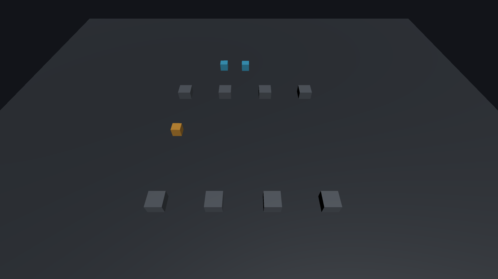

# Install SocketJack Premium and connect two players

This guide gets a local game running before you add accounts, Internet routing or voice. The setup wizard creates the surrounding multiplayer workflow; your player prefab keeps its game-specific appearance and rules.

## Before importing

- Use **Unity 6.3 LTS** as the primary bracket, or **Unity 2022.3 LTS** for compatibility. The checked Windows Editors are 6000.3.27f2 and 2022.3.17f1.
- Set API Compatibility Level to **.NET Standard 2.1**. Start in a version-controlled project and save the open scene.
- Keep one SDK installation in the project. Mixing an older DLL, new component sources and another UPM copy causes duplicate types or incompatible protocols.
- Select the renderer you already use. SocketJack supports Built-in, URP, HDRP and Custom RP networking; your game still needs materials and shaders for that renderer.

For the shortest first test, use the default keyboard controls with Active Input Handling set to **Input Manager (Old)** or **Both**. For an Input System-only project, configure the supplied `NetworkInputBridge` as described below.

## 1. Import the complete distribution

Choose one route:

| Format | What to do |
| --- | --- |
| Asset Store | Import the complete asset. Its `Runtime/Components` sources, optional Web/Voice modules, demo and offline documentation are included. |
| UPM tarball | In Package Manager choose **Add package from tarball** and select the supplied `com.socketjack.multiplayer-2.0.0.tgz`. Import **Physics Arena** from its Samples tab when you want the demo. |
| NuGet | Use the six matching-version packages for standalone .NET applications. Unity does not automatically import NuGet `contentFiles`; follow the runtime README to copy the appropriate DLLs and editable components into a deliberate assembly layout. The base `.nupkg` includes a quick start, not the complete demo scene. Obtain the demo from the Asset Store/UPM distribution or repository examples. |

Wait for compilation to finish. The complete distribution includes managed Opus and the JSON dependencies with their license notices. It does not require a native Opus accelerator, a downloaded SQLite plugin or a paid hosted service. Native account hosting uses the operating system's SQLite library; ordinary game clients do not host a database.

## 2. Prepare a player prefab

1. Put a visible player, its collider and a `Rigidbody` or `Rigidbody2D` in a test level with a floor.
2. Save that player as a prefab. Keep its existing mass, damping, material and collision settings.
3. Keep any player camera, AudioListener and local input script on clearly identifiable children/components. You will assign these as local-only targets.
4. Remove the original scene player after the network spawner is configured. Keeping both creates an unowned single-player copy beside the network player.

For a 3D first test, use a dynamic Rigidbody and a simple capsule or cube. For 2D, choose a platformer with gravity and a floor, or a top-down body with the gravity setting appropriate to your game. See [physics and authority](physics-and-authority.md) before choosing how remote bodies simulate.

## 3. Run the setup wizard

Open **Tools → SocketJack → Setup Multiplayer**.

1. Select your player prefab and a `NetworkPrefabRegistry` asset. Create a registry through **Assets → Create → SocketJack → Network Prefab Registry** if needed.
2. Choose **Rigidbody3D**, **Rigidbody2D** or **ExistingController**. ExistingController synchronizes a transform; it does not automatically reproduce your custom controller's simulation on the server.
3. Choose **Host/Peer** for a player-hosted game, or **Dedicated Server/Client** for a separate server. Select UDP for the first native test.
4. For this first anonymous connection test, deselect **MMO chat, accounts and website** and **Account-backed voice (microphone off)**. The complete wizard otherwise enables these additions and requires sign-in before joining. Leave them enabled when following the ticketed flow in [accounts and hosting](accounts-and-hosting.md) instead.
5. Review the proposed changes, then apply them. Reopening the wizard does not edit the project until you apply.
6. Save the scene, prefab and registry.

The scene has a `NetworkManager`, player spawner and connection controls. The prefab has its identity, selected movement/controller and local-player helpers. The manager identifies the connection; each prefab identity identifies one shared object. They have different jobs.

The registry assigns stable prefab IDs. Preserve both IDs and stable keys in every player/server build. Reordering entries must not change which prefab an ID means.

## 4. Assign local-only objects and input

On `NetworkLocalPlayer`, assign your camera, AudioListener and input script under **Local Behaviours**, or assign a local-only child under **Local Objects**. Do not select the network root, identity, movement synchronizer or another networking component. Remote objects must keep receiving network simulation while their local camera/input is disabled.

For the Input System, add `NetworkInputBridge` to the player and assign your InputActionReference assets to **Move** (Vector2) and **Jump** (button). The bridge clones actions for the local player, gates them by ownership/readiness and feeds `SetInput`. It disables the physics component's built-in keyboard reader. The optional **Use Default Keyboard** fallback supplies WASD/arrows and Space for unassigned actions; disable it when only your configured action bindings should drive movement.

## 5. Bind your menu

The supplied `NetworkSessionControls` exposes UnityEvent-compatible actions:

| Button | Method |
| --- | --- |
| Host | `Host()` — selects Host/Peer and starts the host/local player |
| Join | `Join()` — uses `StartPeer()` for Host/Peer, or `StartClient()` for Dedicated Server/Client |
| Start server | `StartDedicatedServer()` |
| Disconnect | `Stop()` |

Assign the address/port while stopped. The joining player uses the listener's address, not its own. The default port is 7777. Two players on one machine can use loopback; a different machine needs the server's reachable address and firewall rules.

For a custom menu, these are the corresponding manager calls:

```csharp
using SocketJack.Multiplayer.Components;
using UnityEngine;

public sealed class MultiplayerMenu : MonoBehaviour
{
    public NetworkManager Network;

    public void Host()
    {
        Network.Topology = NetworkTopology.HostPeer;
        Network.StartHost();
    }

    public void JoinHost()
    {
        Network.Topology = NetworkTopology.HostPeer;
        Network.StartPeer();
    }

    public void StopGame() => Network.Shutdown();
}
```

This assumes the wizard's registry and spawner are already configured. It does not replace them. For account-required games, use the ticketed flow in [accounts and hosting](accounts-and-hosting.md); anonymous `StartHost()`/`StartPeer()` calls cannot replace authentication.

## 6. Verify in two builds

1. Build the same saved scene and registry into two native players.
2. Start Host in the first, then Join in the second.
3. Move each player separately. Only its own camera/input should activate; both views should see the other player's motion.
4. Join a third player after movement. It should receive current object state and selected-member baselines.
5. Disconnect one player. Its owned player should disappear without disabling the remaining player.
6. Repeat with TCP if you intend to offer it, then test a second machine and your intended public-network path.

Actual acceptance covers native Windows Mono on both named Editors, including 3D/2D physics. Unity 2022.3 WebGL/IL2CPP has separate real-browser WebSocket gameplay and account/voice checks. Browser clients cannot host raw UDP/TCP listeners. Other targets and Unity 6 WebGL need their own target-specific acceptance.



*The supplied Physics Arena in a real Unity 2022.3 Windows player: one host and two loopback UDP peers, all moving through autoplay test input. This is an uncomposited readback of the sample's live camera, with three admitted players and zero hard corrections in that local run. It shows the successful sample result, rather than the appearance of your own game or a public-network capacity test.*

Next: [convert your existing controller](convert-existing-game.md), then [gameplay synchronization](game-sync.md).
