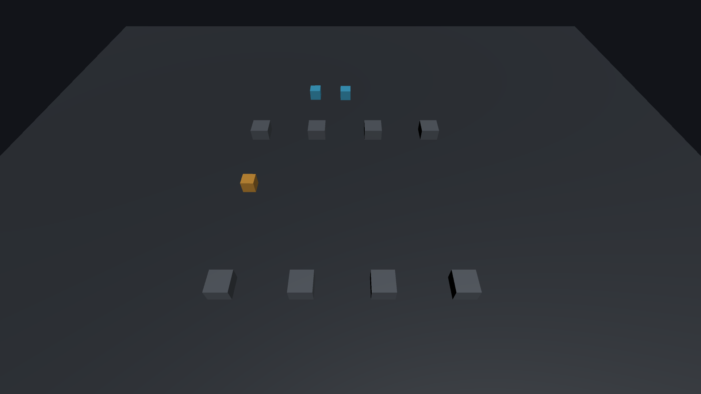

# Configure 3D and 2D physics

SocketJack's physics components send player intent, simulate native physics and use sparse canonical keyframes to repair divergence. They are useful starting motors for a Rigidbody game. They do not make Unity physics deterministic or provide full collision rollback.

*Actual Unity 2022.3 Windows sample, using one host and two loopback UDP peers with autoplay input. The live camera shows the orange local player and cyan remote players. All three moved in the captured run; a single image illustrates the sample, while the accompanying runtime checks verify its synchronization.*

## Choose a synchronizer

| Your object | Component |
| --- | --- |
| 3D Rigidbody movement | `SocketJackObject` |
| 2D Rigidbody2D platformer or top-down movement | `SocketJackObject2D` |
| Simpler/custom transform-driven movement | `NetworkTransform`, plus your own simulation/ownership integration |

Use one state controller on a network root. Do not combine `NetworkTransform` with a physics synchronizer on that root. Each requires a `NetworkIdentity`; the physics components add the required identity and native body through Unity's RequireComponent behavior. Collider shape and visible content remain your responsibility.

## 1. Decide who controls motion

The manager's **Server Authority** is the default. Each physics prefab can select **Inherit Manager**, **Server** or **Owner** under Authority. The server resolves this at spawn.

| Choice | Behavior and trust |
| --- | --- |
| Server | Owner input is sent to the server. The server validates ownership/view/sequence and simulates the canonical body. Clients predict and repair from canonical keyframes. Use this for competitive game rules. |
| Owner | The owning client supplies canonical motion state; the server validates the codec, current ownership and visibility before relaying it. Use it only where trusting that player's motion is acceptable. |

Ownership still determines the local camera/input player in either mode. Server authority does not make every server-owned camera local. Member authority is separate: server health and owner cosmetic fields can coexist on either physics mode.

The server can transfer ownership with `NetworkManager.TransferOwnership(objectId, newOwnerId, authoritativeServer)`. The optional last argument can change motion authority at the same time. Epoch/view changes reset prediction/input history and invalidate old-owner traffic. Do not change local identity fields to impersonate a transfer.

## 2. Select native simulation and colliders

Both physics components use the same Inspector movement modes:

| Inspector mode | Body simulation | Colliders in the root's hierarchy |
| --- | --- | --- |
| Static w/Colliders Enabled | Kinematic | Enabled |
| Static | Kinematic | Disabled |
| Physics Enabled | Dynamic | Disabled |
| Physics w/Colliders Enabled | Dynamic | Enabled |

These modes change the body simulation/collider switches needed for the selected behavior, including child colliders. Native mass, damping, material, constraints and interpolation are not replaced with a universal preset. Check the collider hierarchy for your game; child collider arrangements and triggers need deliberate testing.

Choose **Physics w/Colliders Enabled** for the first colliding player test. Choose the collider-free modes only when your game has another collision strategy. Two separate Unity processes do not share a single physics world; network state keeps their local worlds approximately aligned.

## 3. Configure a 3D player

1. Add a Rigidbody and a suitable collider to the root prefab.
2. Add `SocketJackObject`; choose the authority and movement mode.
3. Set Movement Force, Max Speed and Jump Velocity for your body's mass and physics timestep.
4. Use Read Keyboard for the legacy sample controls, or disable it and feed `SetInput(horizontal, vertical, jump)` from `NetworkInputBridge`/your input code.
5. Assign an optional **Visual** child for correction smoothing. Keep colliders on the simulated body rather than the smoothed visual child.

The built-in 3D motor interprets horizontal/vertical as X/Z intent. Your character controller, vehicles, ladders and special abilities may need an `INetworkInputMotor`. Do not leave a second movement script directly overwriting the same Rigidbody each frame.

## 4. Configure a real 2D player

Use `SocketJackObject2D` with a `Rigidbody2D` and `Collider2D`. It uses the 2D physics engine, not a flattened 3D body.

For **Platformer**:

1. Select Movement → Platformer. Horizontal input moves along X; jump uses a grounded check.
2. Set the body's Gravity Scale and rotation constraints for your game.
3. Set Ground Layers, Ground Probe Distance and Minimum Ground Normal Y so floor contact is accepted while walls are not ground.
4. Tune Jump Velocity and test the actual collider shape on slopes and platform edges. The ground cast uses a bounded hit buffer; this is not a full platforming controller with coyote time or moving-platform rules.

For **TopDown**:

1. Select Movement → TopDown. Both input axes move in the XY plane.
2. Set Gravity Scale to 0 if your game should not fall downward. SocketJack preserves the native setting rather than silently overwriting it.
3. Configure friction and rotation constraints appropriately. Keep Z as visual depth; 2D snapshots preserve it without adding 3D collision.

Full, Balanced and Compact profiles are supported for both. Reduced 2D snapshots encode planar rotation/velocity; do not use them to represent a nonplanar 3D body.

## 5. Tune correction after movement works

Start with the component defaults, then watch `LastPositionError`, `PeakPositionError`, `HardCorrections` and `PeakVisualStep` under representative latency.

| Setting | Purpose |
| --- | --- |
| Keyframe Rate | Sparse authoritative repair, default 5 Hz; allowed 1–20 Hz. This is separate from local physics simulation. |
| Correction Time / Max Correction Speed | Spread small positional repair over time with bounded velocity changes. |
| Correction Dead Zone | Avoid responding to insignificant error. |
| Snap Distance | Hard repair for large divergence. Hiding every large error can leave a permanently wrong body. |
| Max Extrapolation | Bound prediction beyond the last received snapshot. |
| Visual / Smoothing Speed | Smooth presentation without moving collision geometry into a second independent simulation. |
| Input Timeout | Stop stale movement intent when updates stop arriving. |

Input uses a compact 15-byte intent, normally up to 30 sends/second with change detection and keepalive. Default delivery is reliable unordered. Keyframes carry revisions so an older UDP repair does not roll a newer state backward.

Repeated large corrections usually indicate mismatched scene geometry, a competing motor, incompatible timestep/force settings or an authority error. Fix those before simply increasing snap distance or reducing correction weight.

## 6. Verify the actual gameplay

Test 3D or 2D in separate players, with server authority and any owner-authority mode you plan to ship. Check movement, jump, collision, input release, late join, ownership transfer and room visibility re-entry. Test UDP and TCP independently when both are offered.

Native acceptance on Unity 6.3.27f2 and 2022.3.17f1 covers real Rigidbody2D platformer/top-down motion, jumps/collisions, quantized keyframes and server/owner authority using a server plus two clients over UDP/TCP. This establishes those scenarios; it does not guarantee identical outcomes for your controller, collision setup or target platform.

Continue with [precision and gameplay state](game-sync.md) and [troubleshooting](troubleshooting.md).
