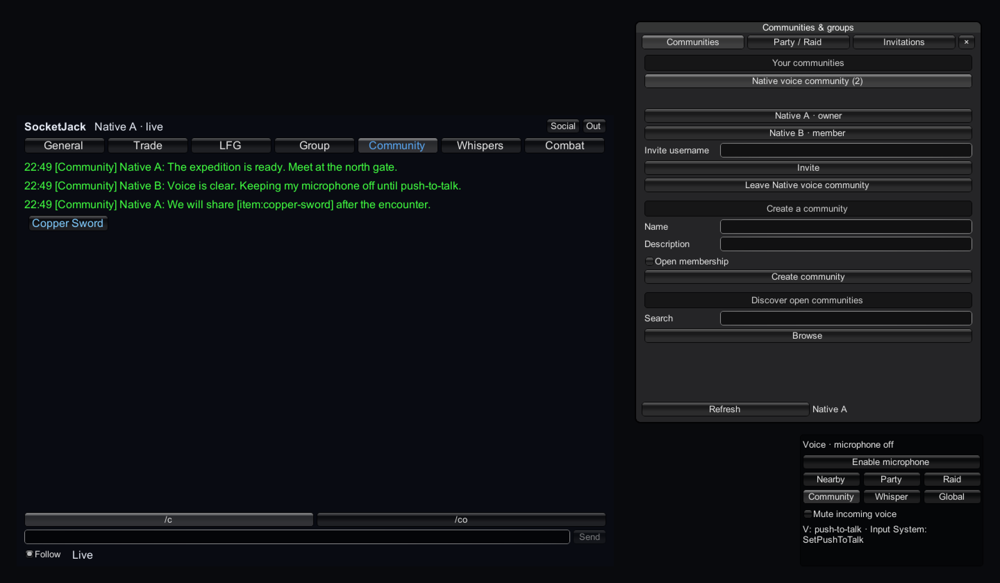

# Add opt-in voice

SocketJack voice uses managed Opus with bounded audio queues, permission-aware routing and explicit microphone opt-in. Add it after ordinary gameplay and account chat work. A voice connection is separate from gameplay movement and text chat.

## Choose a route

| Route | Use it for |
| --- | --- |
| Native game connection | Low-latency voice among peers on one game server, using unreliable voice frames and authenticated membership. |
| Account WebSocket | Account voice through `/ws/voice`, with canonical group/Community permissions and linked-server Global/Community channels. |
| WebGL | Browser account WebSocket plus Web Audio capture/playback adapters. A browser cannot send raw game UDP. |

No hosted voice service is bundled. You run the listening account/game services and supply reachable TLS/WSS endpoints when needed. Plain UDP/TCP voice has the confidentiality properties of that game transport; choosing a voice channel does not add encryption.

## 1. Add the optional modules

The complete Unity distribution already includes the Voice components and managed Concentus Opus dependency. If installing modules manually, keep versions matched:

- `SocketJack.Unity.Voice`: codec, native routing and Unity capture/playback.
- `SocketJack.Unity.Voice.Web.Client`: authenticated account voice client; no account database/server dependency.
- `SocketJack.Unity.Voice.Web`: native authenticated voice host and linked-server integration.

Retain the included third-party notices. Do not add a native Opus accelerator or another copy of Concentus to the project. The complete assembly layout excludes native server hosting from WebGL.

## 2. Configure authenticated account voice

On the native listening services object, use `NetworkManager`, `SocketJackWebHost`, `SocketJackVoiceManager` and `SocketJackWebVoiceHost`. The Web voice host registers the account endpoint and supplies authenticated game-voice membership. Keep **Allow Trusted Guests** disabled for an account-required game.

On the client services/UI object:

1. Add `SocketJackWebClientBehaviour` and configure the account endpoint.
2. Add `SocketJackVoiceManager` and `SocketJackVoiceControls`.
3. Add `SocketJackWebVoiceClient` beside them. It connects after sign-in by default.
4. Optionally add `SocketJackMMOChatPanel` so selected chat users and group/Community scopes can drive voice selection.
5. Sign in through the account UI, then explicitly enable microphone capture.

Use the same canonical account service as text chat. Do not put a bearer token in a URL or scene asset. The account bridge sends authentication in the bounded opening message and validates the service certificate normally. An HTTPS game page needs WSS.

Account sign-out, permission revocation and connection replacement revoke the old stream. The client clears incoming audio on disconnect/sign-out and keeps the explicitly selected account route; it does not silently fall back to anonymous game voice.



This is the running Unity UI with synthetic example accounts. The microphone remains off until the player chooses to enable it. The Community selection comes from canonical membership, not a client-created permission flag.

## 3. Enable microphone and push-to-talk deliberately

Adding a voice component does not open the microphone. Leave **Start Microphone** off. The supplied control panel exposes **Enable microphone**, **Stop microphone**, channel selection and incoming mute.

The default native push-to-talk key is V when the legacy input reader is enabled. For an Input System-only game, disable the Voice Manager's **Read Keyboard** and call `SetPushToTalk(bool)` from your action/button callbacks:

```csharp
using SocketJack.Multiplayer.Voice.Components;
using UnityEngine;

public sealed class VoiceButtons : MonoBehaviour
{
    public SocketJackVoiceManager Voice;

    public void EnableMicrophone() => Voice.StartCapture();
    public void StopMicrophone() => Voice.StopCapture();
    public void PushToTalkDown() => Voice.SetPushToTalk(true);
    public void PushToTalkUp() => Voice.SetPushToTalk(false);

    private void OnDisable()
    {
        if (Voice == null) return;
        Voice.SetPushToTalk(false);
        Voice.StopCapture();
    }
}
```

Call capture methods on Unity's main thread. A released/disabled input action must send false; otherwise the game may keep the manual PTT state pressed. Capture off and PTT released are different controls: release stops transmission, while StopCapture releases the capture device.

`MutePlayback` mutes incoming voice and revokes buffered speakers. `IsCapturing`, `IsTalking`, `FramesReceived`, `PlayedFrames`, `PlaybackSamples`, `SpeakerCount` and `LastError` help your UI show the actual state. A packet counter alone does not prove audible playback.

## 4. Select a permitted audience

| `VoiceChannel` | Selection |
| --- | --- |
| Proximity | Nearby permitted players from trusted game presence/position; spatial playback. |
| Party / Raid | The canonical group ID in `ScopeId`. |
| Community | The canonical Community ID in `ScopeId`. |
| Whisper | The canonical account ID in `TargetAccountId`. |
| Global | Authorized accounts in the linked service audience. |

Scope and target values request routing; they do not grant membership. Use the social UI/API to obtain real group IDs. The server resolves and filters recipients. It does not trust a position or display name supplied by the speaking client. Nonproximity channels do not broadcast precise player coordinates.

For native game transport, `TransmitObject` should be the ready locally owned player identity. The manager can select a suitable owned object when unset, but assigning the intended player avoids ambiguity when the peer owns multiple objects. Ownership/view epochs invalidate old-owner frames.

Native membership defaults to deny when no provider is configured. A game can implement `IVoiceMembershipProvider` or use the authenticated Web bridge. **Allow Trusted Guests** is an explicit opt-in demo/trusted-game mode limited to Proximity/Global; it is not an account/party authorization system.

## 5. Add the browser adapters

For WebGL, add:

- `SocketJackBrowserVoiceSocket` beside `SocketJackWebVoiceClient`.
- `SocketJackBrowserMicrophone` beside `SocketJackVoiceManager`.

The distribution includes their `.jslib` plugins. Preserve those files and assembly/platform settings when copying modules manually. Native builds continue to use native microphone/AudioSource behavior.

Bind a user click/tap to `SocketJackBrowserMicrophone.EnableAudio()` to resume browser output. Bind explicit microphone opt-in to `StartCapture()`; the browser owns its permission prompt. HTTPS/WSS and browser device permissions still apply. Set Listener Transform to your active listener/camera when spatial playback needs that position.

WebGL uses Web Audio rather than Unity's unsupported native microphone/audio-filter path. It runs bounded codec work on the main thread; the active browser speaker limit is lower than the native default. Do not infer browser support by testing only inside the Editor.

## 6. Understand latency and bounds

Defaults are mono **16 kHz**, **20 ms** frames, **24 kbit/s** target Opus, up to **256 encoded bytes/frame**, and a bounded **10-frame jitter window** with an initial 3-frame delay. Native playback defaults to 32 active speakers; browser processing is bounded to 8. Packet/routing/recipient budgets are also enforced.

Native voice uses unreliable delivery with its own per-speaker stream sequence/jitter handling. Losing an old audio frame is preferable to building an ever-growing reliable queue. Account voice uses a separate WebSocket; stale audio is dropped from bounded queues. TCP/WebSocket reliability can still add delay during loss.

The account relay defaults to 4,096 connected sockets, 32 concurrent talkers, up to 4,096 authorized recipients per frame and eight queued frames per destination. It also has an overall forwarding budget and a 500 ms audio-age limit. These are configurable safety bounds, not measured throughput guarantees for your host. Size the audience, CPU and bandwidth for the voice channels you actually enable.

The supplied system does not record microphone audio into text history or a voice archive. If your game adds recording, moderation capture or transcription, design and disclose that separate feature yourself.

## 7. Verify capture, routing and playback

1. Sign in two distinct test accounts and verify text chat first.
2. Enable microphone explicitly on one client; check capture and PTT state, then verify decoded playback on the other.
3. Release PTT and confirm transmission stops. Stop capture and confirm the device is released.
4. Test group/Community membership and a nonmember. Check Proximity from trusted player positions.
5. Mute, disconnect, reconnect and sign out. Old buffered audio must stop; the reconnected speaker must play again.
6. Test two actual devices with headphones, OS permissions and the intended audio output. Tune your own sound mix and echo/feedback strategy.

Actual acceptance uses real native Unity 6/2022 players with Opus and AudioSource DSP, UDP/TCP routing, and authenticated hub/leaf account voice. Separate **Unity 2022 WebGL/IL2CPP** browser acceptance exercises account login/chat, bidirectional Opus/Web Audio, fake-device capture, PTT and logout cleanup. Synthetic PCM/fake devices establish the software path; they do not establish microphone hardware, physical speaker output or Unity 6 WebGL acceptance.

See [chat and Communities](chat-and-communities.md), [hosting](accounts-and-hosting.md) and [troubleshooting](troubleshooting.md).
